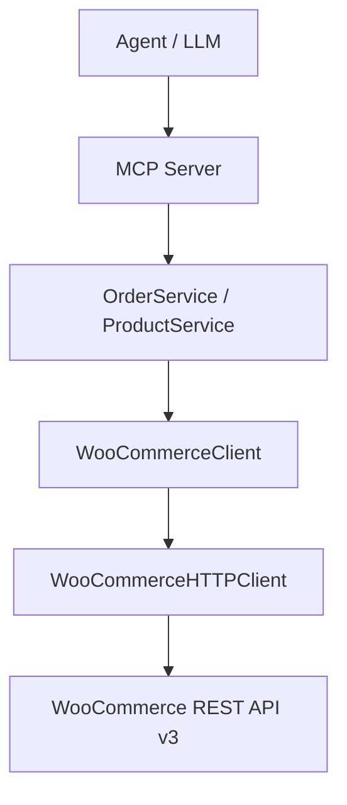

# WooCommerce Agent Connector

A read-only MCP connector that lets an AI agent query orders, products, and inventory from a WooCommerce store.

## What it does

Exposes seven MCP tools over a WooCommerce REST API connection:

| Tool | Description |
|------|-------------|
| `get_order` | Fetch a single order by ID |
| `list_orders` | Paginated list of recent orders |
| `search_orders` | Filter orders by status, customer email, or search term |
| `get_product` | Fetch a single product by ID |
| `list_products` | Paginated product listing |
| `search_products` | Filter by name, SKU, or stock status |
| `get_inventory` | Paginated stock levels across all products |

The connector is strictly read-only. There are no tools to create, update, delete, or refund anything.

## Architecture

```
Agent
  ↓
MCP tools  (app/mcp/server.py)       — thin layer, no business logic
  ↓
Services   (app/services/)           — filtering, pagination, validation
  ↓
WooCommerce client (app/client/)     — HTTP + retry/rate-limit handling
  ↓
WooCommerce REST API v3
```



## Setup

Python 3.11+ required.

```bash
git clone <repo>
cd woocommerce-agent-connector
python -m venv .venv
.venv\Scripts\activate        # Windows
# source .venv/bin/activate   # macOS/Linux
pip install -r requirements.txt
```

## Configuration

Copy `.env.example` to `.env` and fill in your credentials:

```bash
cp .env.example .env
```

```
WC_STORE_URL=https://your-store.com
WC_CONSUMER_KEY=ck_...
WC_CONSUMER_SECRET=cs_...
```

### Getting WooCommerce API keys

1. In your WordPress admin, go to **WooCommerce → Settings → Advanced → REST API**
2. Click **Add key**
3. Set permissions to **Read** (this connector needs nothing more)
4. Copy the consumer key and secret into `.env`

If you don't have a store, [LocalWP](https://localwp.com/) lets you spin one up locally with WooCommerce in a few minutes. Install the WooCommerce plugin, add a few test products, then generate a Read-only API key.

## Running locally

Start the MCP server (stdio transport, for use with MCP clients like Claude Desktop):

```bash
python -m app.main
```

Or run it directly via the MCP CLI:

```bash
mcp run app/main.py
```

The server speaks over stdio by default, which is the standard transport for desktop MCP clients.

## MCP tools

### Orders

**`get_order(order_id: int)`**
Returns: `{id, status, currency, total, date_created, customer_email, customer_id, number}`

**`list_orders(page: int = 1, per_page: int = 20)`**
Returns: `{orders: [...], page, per_page}`

**`search_orders(status?, customer_email?, search?, page?, per_page?)`**
- `status`: `processing`, `completed`, `pending`, `on-hold`, `cancelled`, `refunded`
- `customer_email`: exact match
- `search`: free-text (order number, customer name)

### Products

**`get_product(product_id: int)`**
Returns: `{id, name, sku, price, regular_price, status, stock_status, stock_quantity, manage_stock, permalink}`

**`list_products(page: int = 1, per_page: int = 20)`**

**`search_products(search?, sku?, stock_status?, page?, per_page?)`**
- `sku`: exact match
- `stock_status`: `instock`, `outofstock`, `onbackorder`

### Inventory

**`get_inventory(page: int = 1, per_page: int = 20)`**
Returns stock fields only: `{id, name, sku, stock_status, stock_quantity, manage_stock}`

## Example agent queries

```
"Show me the last 5 processing orders."
→ search_orders(status="processing", per_page=5)

"Find orders from priya@example.com"
→ search_orders(customer_email="priya@example.com")

"Which products are out of stock?"
→ search_products(stock_status="outofstock")

"Get details for product SKU KB-PRO"
→ search_products(sku="KB-PRO")

"Check stock levels across the catalogue"
→ get_inventory(page=1, per_page=50)
```

## Authentication

WooCommerce REST API uses HTTP Basic Auth with consumer key + secret. The credentials are passed as a Basic Auth header via httpx — they never appear in query params or logs.

Credentials are loaded exclusively from environment variables (via `pydantic-settings`). There is no fallback to code defaults.

## Rate limits and retries

The HTTP client handles retries transparently:

| Status | Behaviour |
|--------|-----------|
| 429 | Respects `Retry-After` header; retries up to `MAX_RETRIES` |
| 500/502/503/504 | Exponential backoff: `1s → 2s → 4s`; stops at `MAX_RETRIES` |
| Timeout / network error | Same exponential backoff |
| 401/403 | Raises `AuthenticationError` immediately — no retries |
| 404 | Raises `NotFoundError` immediately — no retries |
| 422 | Raises `ValidationError` immediately — no retries |

Default `MAX_RETRIES=3`. Configurable via `.env`.

Timeout defaults: connect=5s, read=30s. Prevents indefinite hangs on unresponsive stores.

## Pagination

All list/search operations require explicit pagination. Maximum `per_page` is 100 (WooCommerce's own API limit). Requests with `per_page > 100` or `page < 1` are rejected before making any HTTP call.

The cap exists to prevent accidental full-catalogue loads — a store with 10,000 products should never be loaded into agent context in one shot.

Filtering happens server-side wherever WooCommerce supports it (status, SKU, stock status, search terms). No in-memory filtering over large datasets.

## Testing

Tests require no real WooCommerce account. All HTTP calls are mocked.

```bash
python -m pytest tests/ -v
```

What's tested:
- Successful GET and response normalisation
- 401/403 → `AuthenticationError`, no retries
- 404 → `NotFoundError`, no retry
- 429 → `RateLimitError` after max retries, `Retry-After` header respected
- 500 → retried, succeeds on recovery
- Exponential backoff timing
- Timeout → `UpstreamServiceError`, retry stops at limit
- Pagination validation (invalid page, per_page over max)
- Order/product search parameter forwarding
- Response model field extraction
- MCP tool registration and schema

## Offline demo

Runs without credentials using fictional merchant data:

```bash
python demo/offline_demo.py
```

## Security

- Credentials come only from environment variables
- No credentials in logs, errors, or HTTP responses
- Read-only API key is sufficient — and all that should be granted
- Raw WooCommerce error bodies are not forwarded to the agent
- Stack traces are logged server-side, not returned to callers

## Limitations

- No support for WooCommerce variations (product variants with different SKUs)
- No webhook or real-time event support — this is a pull-only connector
- `search_orders` by customer email uses WooCommerce's `search` param, which does a broad text match rather than a strict email lookup
- Stock quantity is only available for products with `manage_stock: true`
- Not tested against WooCommerce versions below 3.5 (REST API v3 baseline)
- No caching — repeated identical queries hit the API each time

## Production considerations

If this were going to production:

1. **Connection pooling** — share one `httpx.AsyncClient` instance across requests rather than recreating it per tool call
2. **Credential validation on startup** — make a test API call at boot to fail fast on bad credentials
3. **Structured logging** — JSON logs with request IDs for tracing
4. **Short-lived cache** — a 30s TTL on `get_product` calls would reduce redundant API hits
5. **OAuth 1.0a** — some WooCommerce setups require OAuth 1.0a signatures instead of Basic Auth over HTTPS
6. **Observability** — latency histograms, retry rate metrics, error rate by status code
